# Linux FHS lab

## System
PRETTY_NAME="Ubuntu 26.04.1 LTS"
NAME="Ubuntu"
VERSION_ID="26.04"
VERSION="26.04.1 LTS (Resolute Raccoon)"

## Root filesystem
TARGET SOURCE    FSTYPE
/      /dev/sda2 ext4

---

## Отчет по практической работе (Снимки экрана)

### 1. Корневой каталог
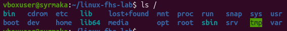
*Проверялся корневой каталог. Абсолютный путь начинается с корня `/`, относительный путь отсчитывается от текущего местоположения.*

### 2. Домашний каталог
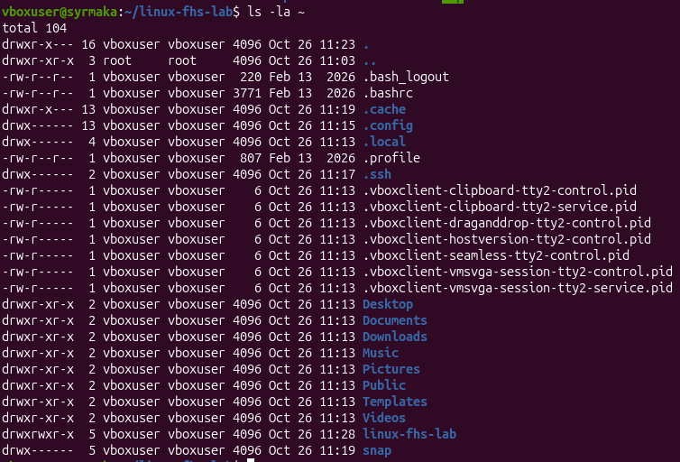
*Проверялся домашний каталог. Скрытые файлы и папки начинаются с точки, поэтому они не видны при обычном выводе `ls`.*

### 3. Каталог /etc и учетная запись
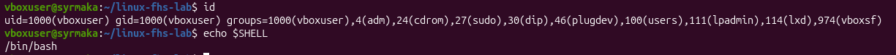
*Версия системы: Ubuntu 26.04.1 LTS. UID и группы видны в выводе команды `id`, домашний каталог и оболочка (shell) определены.*

### 4. Программы и PATH
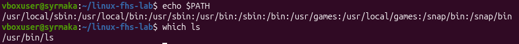
*Оболочка находит программу, перебирая по очереди каталоги, перечисленные в переменной окружения PATH.*

### 5. Изменяемые данные
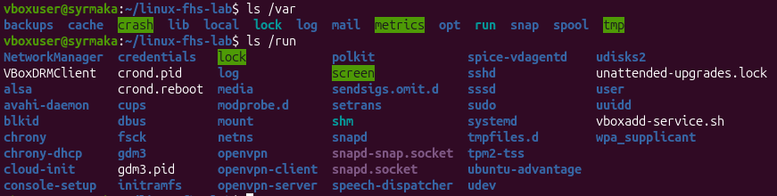
*Назначение каталогов: /var/lib — постоянные данные программ, /var/log — журналы, /var/cache — кэш, /run — сведения о работающей системе до перезагрузки.*

### 6. Устройства
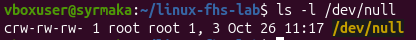
*Файл /dev/null является символьным устройством (буква `c` в правах доступа). Команда завершилась с кодом 0 (успешно).*

### 7. Файлы /proc
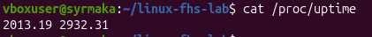
*Каталог /proc — это виртуальная файловая система. Файлы в ней не хранятся на диске, а генерируются ядром при чтении, поэтому копия файла не меняется вместе с оригиналом.*

### 8. Сетевые интерфейсы
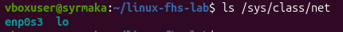
*В системе присутствуют стандартные интерфейсы, например `lo` (петлевой интерфейс) и физический/виртуальный адаптер.*

### 9. inode и ссылки
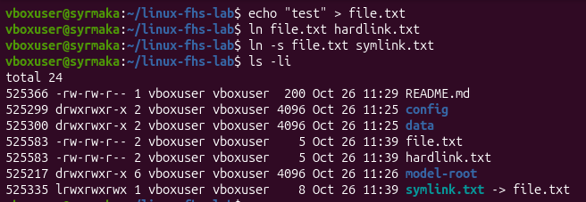
*Жесткая ссылка указывает на тот же inode, что и оригинал (одинаковый номер inode), а символическая ссылка — это отдельный файл, содержащий путь к оригиналу.*

### 10. Место на диске
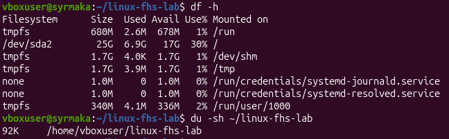
*`df` показывает свободное место на файловых системах целиком, а `du` вычисляет размер, занимаемый конкретными файлами и каталогами.*

### 11. Монтирование tmpfs
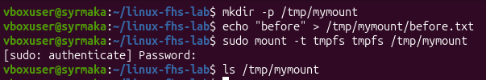
*После монтирования tmpfs в каталог /tmp/mymount, старые файлы (before.txt) перестали быть видны, так как поверх старой директории смонтировалась новая пустая файловая система.*

### 12. Отключение tmpfs
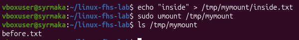
*После размонтирования (umount) файл inside.txt пропал, так как он хранился только в оперативной памяти (tmpfs) и был удален вместе с отмонтированной файловой системой.*

### 13. Файлы shop-api
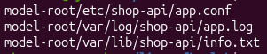
*Файлы приложения shop-api распределены по FHS: конфигурация в /etc, журналы в /var/log, постоянные данные в /var/lib.*

---

## Итоговая задача

Анализ путей службы shop-api:

1. `/home/admin/shop.log` — **Заменить**. Правильный путь: `/var/log/shop-api/shop.log`. Основание: журналы служб должны находиться в `/var/log`.
2. `/usr/bin/config.json` — **Заменить**. Правильный путь: `/etc/shop-api/config.json`. Основание: конфигурационные файлы должны находиться в `/etc`.
3. `/tmp/database.db` — **Заменить**. Правильный путь: `/var/lib/shop-api/database.db`. Основание: постоянные изменяемые данные должны находиться в `/var/lib`, а не во временной папке `/tmp`.
4. `/etc/shop-api/app.conf` — **Оставить**. Путь уже верный (настройки в `/etc`).
5. `/var/log/shop-api/access.log` — **Оставить**. Путь уже верный (журналы в `/var/log`).
6. `/var/lib/shop-api/database.db` — **Оставить**. Путь уже верный (данные в `/var/lib`).