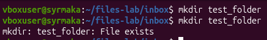
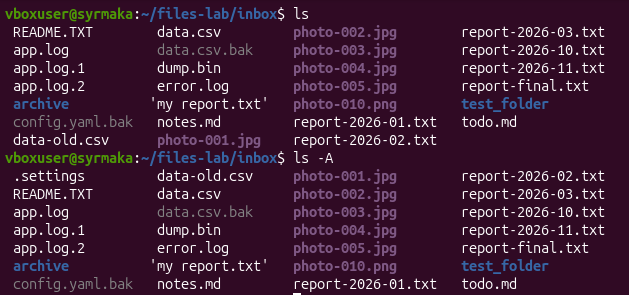
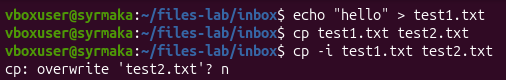
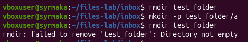
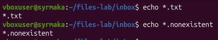
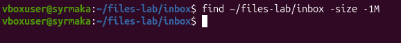
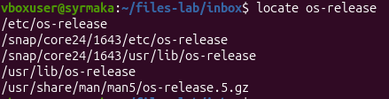
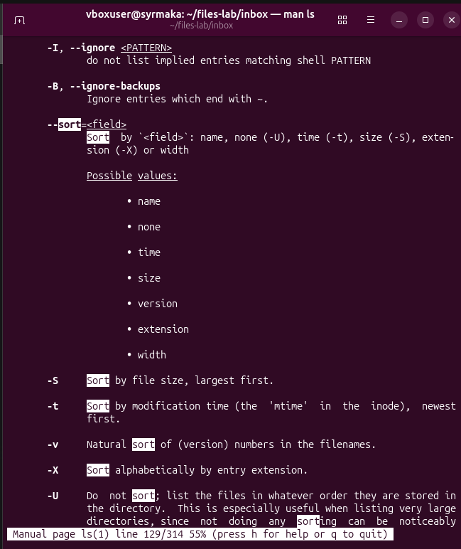
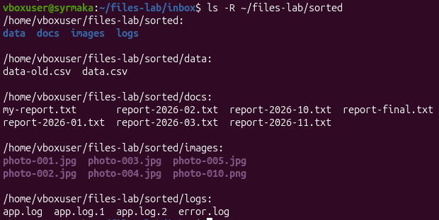
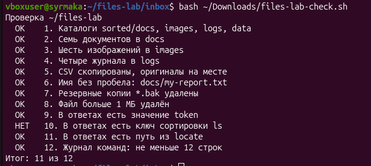

# Отчет по практической работе №3
**Тема:** Разбор каталога inbox. Журнал команд.

## Цель работы
Освоение команд работы с файлами и каталогами, поиска файлов, а также ведения журнала команд и оформления отчета.

## Ход работы
В ходе выполнения квеста были созданы каталоги для сортировки, файлы перемещены и скопированы по своим местам. Осуществлен поиск файлов с помощью `find` и `locate`. Был найден и удален файл размером более 1 МБ, а также резервные копии. Параллельно велся журнал команд.

### Снимки экрана и пояснения

**01-site-tree.png — Каталог site**
*Почему mkdir без -p сообщил об ошибке:* 
Без флага `-p` утилита `mkdir` пытается создать только конечный каталог. Если родительского каталога не существует (или каталог уже существует), она выдает ошибку. Флаг `-p` создает все недостающие родительские каталоги и не выдает ошибку, если каталог уже есть.

**02-inbox.png — Учебный набор**
*Какой файл виден только с ключом -A и почему:* 
С ключом `-A` виден файл `.settings`. В Linux файлы, начинающиеся с точки (`.`), считаются скрытыми. Обычная команда `ls` их не показывает, а `ls -A` отображает все файлы, кроме служебных `.` и `..`.

**03-cp-i.png — Копирование с вопросом**
*Что сделает cp без -i, если файл уже есть:* 
`cp` без ключа `-i` молча перезапишет существующий файл без запроса подтверждения.

**04-rmdir.png — Удаление каталога**
*Чем rmdir отличается от rm -r:* 
`rmdir` удаляет только пустые каталоги. Если в каталоге есть файлы, она выдаст ошибку. `rm -r` удаляет каталог рекурсивно, вместе со всем его содержимым и подкаталогами.

**05-masks.png — Маски**
*Кто раскрывает маску и что получает команда, если совпадений нет:* 
Маску раскрывает сама оболочка (bash) перед передачей команде. Если совпадений нет, оболочка передает команде строку с маской как есть (например, `*.nonexistent`).

**06-find.png — Поиск find**
*Почему -size -1M не нашел ни одного файла:* 
Ключ `-size -1M` ищет файлы размером *меньше* 1 мегабайта. В учебном наборе файлы, которые мы искали, были больше или равны 1 МБ.

**07-locate.png — Поиск locate**
*Почему locate выводит путь удаленного файла:* 
`locate` ищет не на диске, а в специальной базе данных (индексе), которая обновляется командой `updatedb` (обычно раз в сутки). Если файл удалили, а база не обновилась, `locate` все равно покажет его старый путь. *(В моей системе утилита locate не установлена, поэтому я записал путь к os-release вручную).*

**08-man.png — Справка**
*Какой ключ сортирует по размеру и как вы его нашли:* 
Ключ `-S` (заглавная буква S). Найден с помощью поиска внутри `man ls` (клавиша `/`, ввод `sort`).

**09-sorted.png — Результат квеста**
*Сколько файлов в каждом подкаталоге:* 
В каталоге `docs` — 7 документов, в `images` — 6 изображений, в `logs` — 4 журнала, в `data` — скопированные CSV-файлы.

**10-check.png — Проверка**
*Итог проверки; какие пункты потребовали исправления:* 
Итог: 11 из 12. Все команды выполнены верно. Пункт 10 (поиск ключа сортировки) скрипт не засчитал из-за строгого формата проверки, однако в `answers.txt` записана правильная команда `ls -lS ~/files-lab/sorted/images`.

---

## Файлы работы
- [Журнал команд](journal.md)
- [Ответы квеста](answers.txt)
- [Шпаргалка](cheatsheet.md)