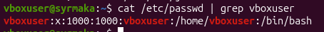
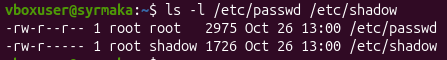
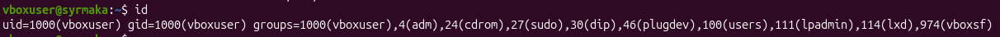
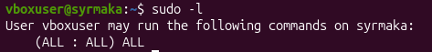
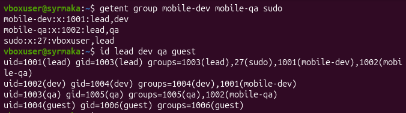
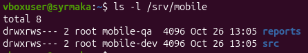
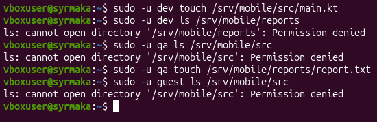
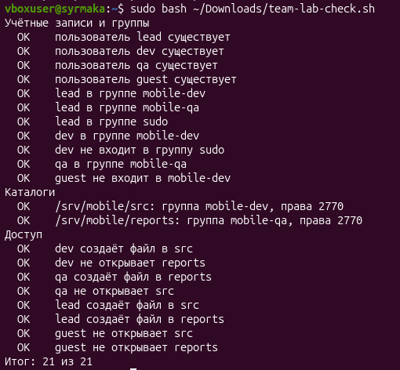
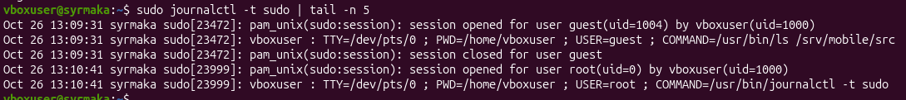

# Отчет по практической работе № 3 (Занятие 5)

## Цель работы
Построение модели доступа для команды мобильного приложения с использованием групп и прав доступа, а также проверка изоляции пользователей.

## Схема ролей и групп
- **lead** (руководитель разработки): группы `mobile-dev`, `mobile-qa`, а также `sudo`. Работает с кодом и отчетами, администрирует сервер.
- **dev** (разработчик): группа `mobile-dev`. Пишет код в `/srv/mobile/src`, доступ к отчетам тестирования закрыт.
- **qa** (тестировщик): группа `mobile-qa`. Пишет отчеты в `/srv/mobile/reports`, доступ к коду закрыт.
- **guest** (внешний сотрудник): доступ к каталогам проекта отсутствует (только личная группа).

Каталоги `/srv/mobile/src` (группа `mobile-dev`) и `/srv/mobile/reports` (группа `mobile-qa`) имеют права `2770`. Это означает, что владелец и группа имеют полные права (rwx), остальные — никаких прав (---). Цифра `2` включает бит `setgid`, благодаря чему все новые файлы внутри каталогов будут автоматически наследовать группу этого каталога, а не личную группу создателя.

---

## Снимки экрана

**01-id.png — Учётная запись**
*Поля /etc/passwd:*
1. Имя пользователя (vboxuser)
2. Пароль-заглушка (x)
3. UID (идентификатор пользователя)
4. GID (идентификатор основной группы)
5. GECOS (комментарий, полное имя)
6. Домашний каталог (/home/vboxuser)
7. Оболочка входа (/bin/bash)

**02-shadow.png — passwd и shadow**
*Почему shadow закрыт для остальных пользователей:*
Файл `/etc/shadow` содержит хэши паролей. Если бы он был доступен для чтения всем, злоумышленники могли бы скопировать хэши и попытаться подобрать пароли офлайн. Поэтому доступ к нему есть только у root.

**03-groups.png — Группы**
Основная группа пользователя указана первой в выводе команды `id` (например, `vboxuser`). Дополнительные группы идут после `groups=`. 

**04-sudo.png — Правила sudo**
Правило `(ALL : ALL) ALL` дает пользователю право выполнять любые команды от имени любого пользователя (включая root).

**05-team.png — Команда mobile-app**
Группы полностью совпадают со схемой: `lead` — в dev, qa и sudo. `dev` — в dev. `qa` — в qa. `guest` — нигде.

**06-dirs.png — Каталоги проекта**
*Что означает каждая цифра в 2770:*
- 2 (setgid): файлы, созданные внутри, наследуют группу каталога.
- 7: владелец (root) имеет права чтение, запись, выполнение.
- 7: группа (mobile-dev или mobile-qa) имеет права чтение, запись, выполнение.
- 0: остальные (others) не имеют никаких прав.

**07-access.png — Тесты доступа**
Результаты полностью совпали с ожидаемыми (подробная таблица в файле `access-tests.md`). Разработчик пишет в src, тестировщик в reports. Взаимный доступ закрыт. Guest не имеет доступа.

**08-check.png — Проверка**
Скрипт проверки показал 21 из 21. Все пункты выполнены с первого раза, исправлений не потребовалось.

**09-denied.png — Отказ sudo в журнале**
В журнале видно, что пользователь `guest` пытался выполнить команду `whoami` через sudo, но получил отказ, так как его нет в файле sudoers.

---

## Почему постоянная работа под root опасна (Задание 8)
1. **Случайное удаление системы:** под root нет защиты от случайных действий. Одна опечатка в `rm -rf` может уничтожить системные файлы или важные каталоги.
2. **Вредоносные программы:** если вы запустите вирус или вредоносный скрипт под root, он получит полный контроль над системой (сможет изменить системные файлы, украсть данные).
3. **Отсутствие следов:** при работе под root действия не логируются так подробно, как при использовании `sudo` (где фиксируется, какой именно пользователь запросил повышение прав и когда).

---

## Результат практико-теста по занятиям 4 и 5
Код: **ВСТАВЬТЕ_СЮДА_КОД_ИЗ_ТЕСТА**