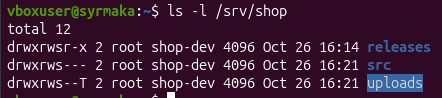
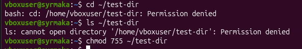
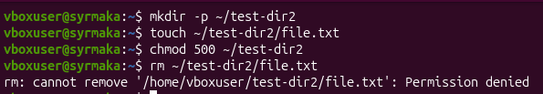
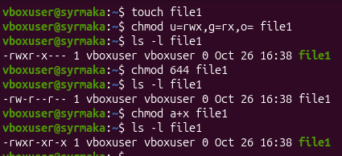
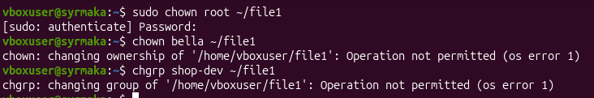
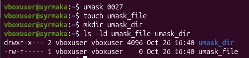
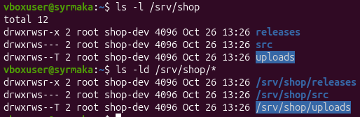
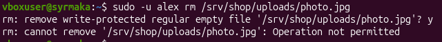
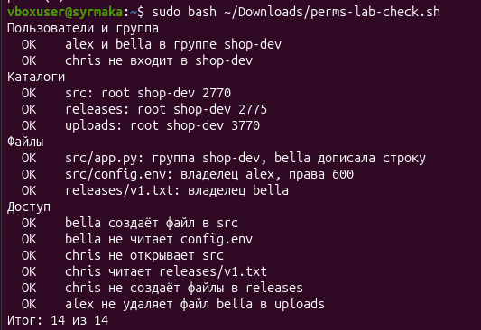

# Отчет по практической работе № 4 (Занятие 6)

## Цель работы
Настройка каталога проекта для команды с использованием прав доступа, битов setgid и sticky, а также маски umask.

## Схема прав каталогов
Для проекта shop были настроены следующие каталоги:
- `/srv/shop/src` — права `2770` (drwxrws---). Разработчики пишут код, остальным доступ закрыт. Бит `setgid` гарантирует, что новые файлы будут принадлежать группе `shop-dev`.
- `/srv/shop/releases` — права `2775` (drwxrwsr-x). Разработчики публикуют сборки, остальные (например, аналитик chris) могут только читать.
- `/srv/shop/uploads` — права `3770` (drwxrws--T). Общая папка для загрузок. Бит `sticky` (T) разрешает удаление файлов только их владельцу (или root).

## Скриншоты и объяснения

**01-ls-l.png — Строка ls -l**
*Поля строки:*
1. **Тип и права** (например, `-rw-r--r--`). Первый символ `-` — обычный файл, `d` — каталог. Далее три тройки: права владельца, группы и остальных.
2. **Количество жестких ссылок**.
3. **Владелец** (alex).
4. **Группа** (shop-dev).
5. **Размер** файла в байтах.
6. **Дата и время** последнего изменения.
7. **Имя** файла или каталога.

**02-dir-rx.png — Каталог без x и без r**
*Объяснение ошибок:*
- Без права `x` (execute) нельзя зайти в каталог (`cd`) и нельзя обратиться к файлам внутри него по имени (даже если вы знаете их названия).
- Без права `r` (read) нельзя вывести список файлов в каталоге (команда `ls`).

**03-dir-w.png — Удаление и право w**
*Почему удаление файла решает каталог, а не файл:*
В файловой системе Linux удаление файла — это изменение содержимого каталога (удаление записи о файле из таблицы каталога). Поэтому право на удаление файла определяется правом `w` (write) на сам каталог, в котором он лежит, а не правами на сам файл. Если у вас нет права `w` на каталог, вы не сможете удалить в нем ничего, даже если вы владелец файла.

**04-chmod.png — chmod буквами и числом**
*Перевод примеров:*
- `u=rwx,g=rx,o=` переводится в число `750` (владелец: 4+2+1=7, группа: 4+1=5, остальные: 0).
- `644` переводится в буквы `rw-r--r--` (владелец: 4+2=6, группа: 4, остальные: 4).
- `a+x` добавляет бит исполнения (x) всем троим (владельцу, группе и остальным).

**05-chown.png — Владелец и группа**
*Почему chown без sudo запрещён, а chgrp на свою группу разрешён:*
Сменить владельца файла (`chown`) может только суперпользователь (root), чтобы злоумышленник не мог присвоить себе чужие файлы (например, системные). Сменить группу (`chgrp`) обычный пользователь может только на ту группу, в которой он сам состоит (членство проверяется ядром системы).

**06-umask.png — umask**
*Права при маске 0027:*
- Файлы создаются с базовыми правами `666`. Вычитаем маску `027`: `666 - 027 = 640` (`rw-r-----`).
- Каталоги создаются с базовыми правами `777`. Вычитаем маску `027`: `777 - 027 = 750` (`rwxr-x---`).

**07-shop-dirs.png — Каталоги проекта**
*Что означает каждая буква в drwxrws--T:*
- `d` — это каталог (directory).
- `rwx` — владелец (root) имеет права на чтение, запись и выполнение.
- `rws` — группа (shop-dev) имеет права на чтение, запись и выполнение. Буква `s` на месте `x` означает, что установлен бит `setgid` (новые файлы наследуют группу каталога).
- `--T` — остальные не имеют прав. Заглавная буква `T` означает, что установлен `sticky-бит`, но остальные не имеют права на выполнение (x). Если бы было `--t`, то право на выполнение было бы.

**08-shop-access.png — Тесты доступа**
*Какой бит или право объясняет каждый результат:*
- `chris` прочитал `releases/v1.txt` — в каталоге `releases` права `2775` (для остальных `r-x`, то есть чтение разрешено).
- `chris` не открыл `src` — в каталоге `src` права `2770` (для остальных `---`, доступа нет).
- `chris` не создал файл в `releases` — у него нет права `w` на каталог (в правах группы `rws`, но chris не входит в группу shop-dev, а для остальных только `r-x`).
- `alex` не удалил файл `bella` в `uploads` — в каталоге установлен `sticky-бит` (`T`), который разрешает удаление файлов только их владельцу (или root), несмотря на то, что у группы есть право записи.

**09-shop-check.png — Проверка**
Скрипт проверки показал 14 из 14. Все пункты выполнены успешно. Единственный пункт, который потребовал исправления — это `src/app.py` (при первой попытке файл не создался корректно, после пересоздания и дописывания через `tee -a` пункт стал `OK`).